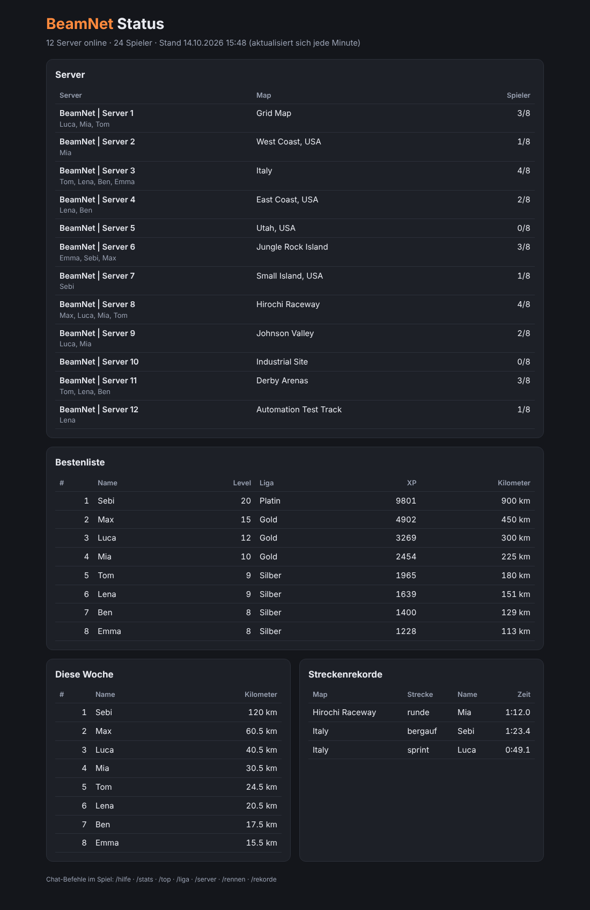
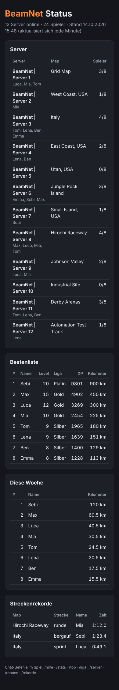
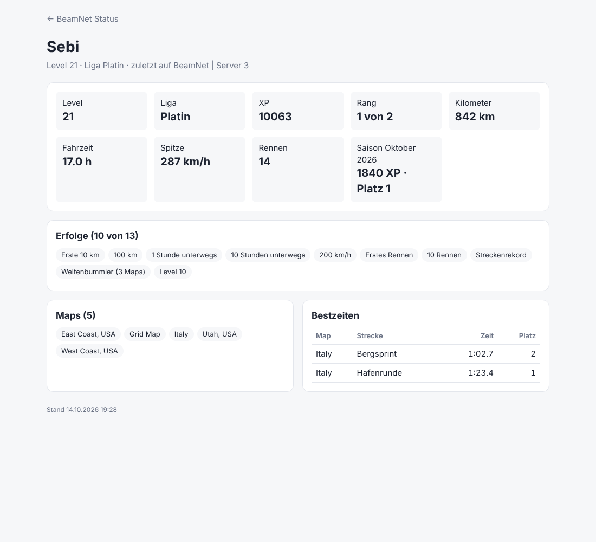

# BeamNet – Werkzeug und Plugin für die BeamMP-Server

English summary: [README.en.md](README.en.md)

Zwei Teile, beide getestet:

1. **`beamnet`** – ein Befehl für die Server-Konsole: zeigt den Zustand aller Server, findet Probleme und repariert sie.
   Dazu ein **Wächter**, der rund um die Uhr Ausfälle, hängende Server, Last, Spielerrekorde, Moderation, neue Spieler
   und Meilensteine an **Discord und Telegram** meldet, alle 10 Minuten zeigt, wer auf welchem Server fährt und welche
   Maps voll sind, im Telegram-Chat Fragen beantwortet (`/heute`, `/woche`, `/teams`, `/saison`, `/spieler` …), täglich die
   Spielerdaten sichert, eine **Bonus-Map des Tages** wählt, **XP-Abende** nach Plan startet, Update-Hinweise gibt und
   eine **Statusseite** mit Bestenlisten, Profilen, Diagrammen und Hilfeseite erzeugt. Plugin-Updates gehen zuerst auf
   einen Testserver.
2. **`BeamNetCore`** – ein Server-Plugin: Kilometer, Fahrzeit, XP und Level, Ligen, Bestenlisten, Saisons mit Titeln,
   Erfolge, Tagesaufgaben, **Zeitrennen** mit Zwischenzeiten, **Gruppenrennen** und **Strecke der Woche**,
   **XP-Events**, **Teams** mit Team der Woche, `/heute`, Wochen- und Saison-Rückblick, Map-Abstimmung, `/wo`, **Freundesliste**, **Fahraufträge** (Krankenhaus, Schule, Taxi …), **Verfolgungsjagd**, **Konvoi**, automatische **Spielerplätze** nach Beliebtheit, **Moderation** (Banns auf allen Servern, `/melden`, Wortfilter,
   Spam- und Verbindungsschutz) und eine Liste aller Server im Chat – gemeinsam für alle Server, auch mit 30+ Spielern
   gleichzeitig (getestet mit 64 Spielern und 5000 Spielerdateien).

## Schnellstart (Web-Konsole des Servers, als root)

Zwei Befehle – der zweite ist ein Assistent, der vor jedem Schritt fragt:

```bash
curl -fsSL https://raw.githubusercontent.com/sebastian10099/Agar.io-bot/claude/friendly-goldberg-31l8fp/BeamNet/beamnet.sh \
  -o /usr/local/bin/beamnet && chmod +x /usr/local/bin/beamnet
beamnet setup
```

`beamnet setup` führt durch: Diagnose → Sicherung → OpenClaw anhalten (falls er stört) → Server reparieren und starten
→ Plugin BeamNetCore installieren (alte Plugins mit gleichen Aufgaben abschalten) → Admins eintragen → Wächter mit
Discord → Statusseite → Neustart. Mit Enter wird ein Schritt übersprungen.

Lieber einzeln? `beamnet status` und `beamnet doctor` ändern nichts; `beamnet backup` und `beamnet fix` reparieren.

**Später auf den neuesten Stand:** `beamnet update` – lädt das neueste Werkzeug und aktualisiert das Plugin auf allen
Servern (ohne Neustart, BeamMP lädt es selbst neu; laufende Sitzungen werden dabei automatisch umgestellt).
`beamnet doctor` zeigt die Plugin-Version je Server. Ist das Werkzeug älter als 1.8 (`beamnet version`), danach
einmal `beamnet install-core` ausführen – alte Versionen aktualisieren nur sich selbst.

**Sicher aktualisieren:** `beamnet update` bzw. `beamnet install-core` spielt eine neue Plugin-Version zuerst auf
**einem** laufenden Server ein (dem mit den wenigsten Spielern). Meldet der sich innerhalb von 60 Sekunden mit der
neuen Version, folgen die übrigen. Sonst kommt dort automatisch die alte Version zurück und das Update bricht ab –
die anderen Server merken nichts davon. (Bei der ersten Installation ohne laufendes Plugin geht es gleich überall;
`BEAMNET_CANARY=0` schaltet den Testserver ab.)

**Zum Teilen:** `beamnet report` erstellt einen Bericht mit Status, Diagnose, Plugins und auffälligen Protokollzeilen –
IP-Adressen und AuthKeys sind darin unkenntlich gemacht. Einfach komplett in den Chat kopieren.

## Befehle

| Befehl | Was er macht |
|---|---|
| `beamnet setup` | Geführte Einrichtung aller Teile (fragt vor jedem Schritt) |
| `beamnet status` | Übersicht: läuft?, Autostart, wer den Prozess gestartet hat, Port, Spieler, Map, Name |
| `beamnet doctor` | Diagnose mit Erklärung und Lösung je Problem (siehe unten) |
| `beamnet report` | Bericht zum Teilen: Status + Diagnose + Plugins + Fehlerzeilen der Protokolle, ohne IPs und AuthKeys |
| `beamnet fix` | Beendet „wilde“ Server-Prozesse (per `nohup` als root gestartet), setzt Dateirechte zurück, richtet die Protokoll-Rotation ein (logrotate), schaltet Autostart ein, startet alles sauber über systemd und prüft danach, ob die Server **an bleiben** |
| `beamnet start / stop / restart [nr … \| all]` | Server steuern; `stop` und `restart` fragen vorher |
| `beamnet maps` | Maps aller Server und die verfügbaren Vanilla-Maps |
| `beamnet set-map <nr> <map>` | Map ändern (sichert vorher, fragt vor dem Neustart); Mod-Maps mit `--force` |
| `beamnet rotation <nr> <map> <map> …` | Tägliche Map-Rotation: jeden Tag die nächste Map der Liste, sobald der Server leer ist (`… <nr> aus` beendet sie) |
| `beamnet slots` | **Spielerplätze nach Beliebtheit:** zeigt je Server die letzten 30 Tage (Spitze, Tage voll, Spielerstunden) und schlägt mehr Plätze vor – +4 für Server, die an mindestens 2 Tagen voll waren, nochmals +4, wenn ihre Map zu den 3 beliebtesten gehört (höchstens 20). Der Wächter stellt das einmal am Tag ab 6 Uhr selbst um, sobald der Server leer ist (`AUTO_SLOTS=0` = nur Vorschlag). `beamnet slots apply` übernimmt sofort, `beamnet slots <nr> <plätze>` setzt von Hand – dann lässt die Automatik diesen Server 30 Tage in Ruhe (`beamnet slots <nr> auto` schaltet sie wieder ein). Am selben Morgen wird ein Server nie zweimal neu gestartet (Map-Rotation und Plätze) |
| `beamnet logs <nr> [zeilen]` | Letzte Zeilen des Server-Protokolls |
| `beamnet plugins` | Installierte (und abgeschaltete) Plugins je Server |
| `beamnet plugin-disable <name>` / `plugin-enable <name>` | Plugin auf allen Servern ab- oder einschalten – verschiebt nur nach `Resources/Server.disabled`, löscht nichts |
| `beamnet restore [JJJJ-MM-TT]` | Tägliche Datensicherungen anzeigen bzw. Spielerdaten auf einen Stand zurücksetzen (Server werden kurz gestoppt, der bisherige Stand bleibt daneben liegen). `beamnet restore <Datum> spieler <Name|ID>` holt nur einen Spieler zurück (z. B. nach einer kaputten Datei; kein Neustart, sein bisheriger Stand wird gesichert). `beamnet restore check [Datum]` stellt probeweise wieder her, ohne etwas zu schreiben (jeder Eintrag sicher, jede Spielerdatei lesbar); der Wächter macht das einmal je Woche mit der neuen Sicherung und meldet Fehler |
| `beamnet players` | Wer gerade fährt: je Server mit Namen (mit BeamNetCore; `players json` = Rohdaten) |
| `beamnet heute` · `woche` · `teams` · `saison` | Überblick wie im Telegram-Chat: Boni von heute, Wochenbeste mit Wochenziel, Teams dieser Woche, Saisonwertung |
| `beamnet backup` | Konfigurationen, Plugins und systemd-Dienste nach `/root/beamnet-backups` (die 20 neuesten bleiben) |
| `beamnet install-core` | Installiert BeamNetCore auf allen Servern |
| `beamnet openclaw status / pause / resume` | OpenClaw-Agent ansehen, anhalten (einfrieren, nichts wird gelöscht) und fortsetzen |
| `beamnet watch install / status / test / uninstall` | Wächter einrichten (siehe unten) |
| `beamnet web install [port]` / `web uninstall` | Statusseite als Webseite (siehe unten), Standard-Port 8080 |
| `beamnet bans` / `unban <Name>` / `modlog [n]` | Banns ansehen und aufheben, Moderationsprotokoll lesen |
| `beamnet admin list / add <Name …> / remove <Name …>` | Admins für Rennen und Moderation – wirksam innerhalb einer Minute, ohne Neustart |
| `beamnet config [<Schlüssel> <Wert>]` | **Spiel-Einstellungen** ohne JSON-Bearbeitung: `beamnet config` zeigt alle (XP je km, Aufträge, Konvoi, Rückkehrer-Bonus, Einsatz-Alarm, „Wo ist was los?“ …) mit Wert und Beschreibung, `beamnet config comebackXp 100` ändert, `beamnet config comebackXp standard` setzt zurück, `beamnet config aufgaben km speed jobs mapkm` wählt die Tagesaufgaben. Geprüft auf Typ und Grenzen, wirksam innerhalb einer Minute ohne Neustart |
| `beamnet update` | Werkzeug **und** Plugin auf allen Servern aktualisieren |
| `beamnet self-update` | Nur das Werkzeug aktualisieren |

Mit `-y` laufen Befehle ohne Rückfrage.

### Was `beamnet doctor` prüft

- Jeder Server: systemd-Dienst vorhanden, läuft, Autostart an, kein Prozess außerhalb von systemd, Dateien gehören dem
  Dienst-Benutzer `beammp`, AuthKey eingetragen, Port nicht doppelt, Port wirklich offen, BeamNetCore meldet sich
  (und keine Fehlermeldungen von BeamNetCore im Protokoll).
- Mehrere Server mit derselben Map.
- **OpenClaw**: läuft der Agent? Hat er in den letzten 24 h Server gestoppt oder beendet? Hat er sudo-Rechte?
- cron-Aufgaben, die BeamMP betreffen (z. B. `auto_install.py` alle 2 Minuten als root).
- SSH-Schlüssel: Anzahl, Fingerabdrücke, ob die Datei in den letzten 24 h geändert wurde.
- Freier Speicherplatz und Arbeitsspeicher.

### Wächter: Ausfälle melden, optional neu starten

```bash
beamnet watch install      # prüft ab jetzt jede Minute alle Server (systemd-Timer)
nano /etc/beamnet.conf     # Discord-Webhook und/oder Telegram-Bot, automatischen Neustart eintragen
beamnet watch test         # Testnachricht an Discord/Telegram
```

- Meldet „🔴 Server 5 (utah) ist ausgefallen“ und „🟢 … ist wieder online“ – im Systemprotokoll und, wenn eingetragen,
  per **Discord-Webhook** und/oder **Telegram-Bot**. Jeder Ausfall wird nur einmal gemeldet.
- **Telegram einrichten:** bei [@BotFather](https://t.me/BotFather) `/newbot` → Token als `TELEGRAM_TOKEN=` in
  `/etc/beamnet.conf`. Chat-ID: dem Bot einmal schreiben (oder ihn in die Gruppe holen) und
  `https://api.telegram.org/bot<TOKEN>/getUpdates` im Browser öffnen → `"chat":{"id":…}` als `TELEGRAM_CHAT=`
  (Gruppen haben eine negative ID, Kanäle gehen auch als `@Kanalname`). Alle Meldungen (Ausfälle, Rekorde, Wochen- und
  Saisonsieger, Tageszusammenfassung, wer online ist) gehen an beide Wege, wenn beide eingetragen sind.
- **Telegram-Bot mit Befehlen:** Im eingetragenen Chat beantwortet der Bot `/online` (wer fährt wo), `/top`
  (Bestenliste), `/rekord` (Spielerrekord) und `/server` (Netzwerk-Übersicht: Spieler je Server und Auslastung je Map), innerhalb einer Minute.
  Nachrichten aus anderen Chats und Befehle an andere Bots (`/online@AndererBot`) ignoriert er, höchstens 5 Antworten
  je Minute (weitere folgen in der nächsten). An mit `TELEGRAM_COMMANDS=1` (neue Installationen: schon an; ältere
  Konfigurationen ohne den Eintrag: aus, damit andere Programme mit demselben Bot-Token weiter ihre Nachrichten
  bekommen). Abschalten: `TELEGRAM_COMMANDS=0`. **Ansagen aus Telegram:** Konten aus `TELEGRAM_ADMINS=123456,789012`
  (Telegram-Zahlen-IDs, z. B. über @userinfobot) dürfen `/ansage [HH:MM] <Text>` schreiben – die Ansage geht an alle
  Server; andere bekommen einen Hinweis, Bots werden ignoriert. **XP-Events aus Telegram:** `/event` zeigt allen, ob
  gerade ein XP-Event läuft und ob ein XP-Abend geplant ist; Admins starten mit `/event 2 2h` (Faktor 1,5–5, Dauer
  10m–6h) und beenden mit `/event stop`. **`/spieler <Name>`** (Teil des Namens reicht) zeigt Level, Liga, XP, Platz,
  Kilometer, Fahrzeit, Spitze, Aufträge, Kilometer dieser Woche, Saison-XP mit Platz und Team eines Spielers; **`/plaetze`** die Auslastung der letzten 30 Tage je Server und
  wo die Automatik mehr Plätze geben wird; **`/woche`** die Top 5 der Kalenderwoche nach Kilometern und den Stand des
  Wochenziels für alle; **`/heute`** Tagesaufgabe, laufendes XP-Event, Bonus-Map, nächsten XP-Abend, Wochenziel und Saisonende auf
  einen Blick; **`/teams`** die Teams nach Kilometern dieser Woche; **`/saison`** die Top 5 der laufenden Saison, das
  führende Team und die Sieger der letzten Saison. Die Befehlsliste trägt der Wächter selbst bei Telegram ein (einmal je Version), Telegram
  schlägt die Befehle dann beim Tippen von „/“ vor – ohne Umweg über @BotFather.
- **Netzwerk-Übersicht:** alle 10 Minuten (`NETWORK_REPORT=…`, 0 = aus), solange jemand spielt:
  ```
  📊 BeamNet: 14 Spieler · 3 von 12 Servern belegt
     Server 1 · italy: 9/10 🔥 – Ana, Max, Sebi +2 Gäste
     Server 3 · utah: 4/10 – Ben, Lena, Tom, Ufuk
     Leer: Server 2, 4, 5, …
     🗺️ Maps: italy 9/10 (90 % 🔥) · utah 4/10 (40 %) · gridmap_v2 1/10 (10 %)
  ```
  Spieler mit BeamMP-Konto stehen mit Namen da, Gäste werden nur gezählt. 🔥 heißt: ab 80 % voll. Bleibt alles gleich,
  kommt die Übersicht höchstens alle 30 Minuten; wird das Netzwerk leer, einmal „gerade niemand online“. Dieselbe
  Übersicht schickt der Bot auf `/server` in Telegram; im Terminal: `beamnet players`. (Ältere Konfigurationen mit
  `ONLINE_REPORT=…` bekommen automatisch die neue Übersicht alle 10 Minuten; `ONLINE_REPORT=0` schaltet sie weiter ab.)
- **XP-Abende:** `sudo beamnet event auto fr,sa 20:00 2 2h` – freitags und samstags um 20 Uhr startet der Wächter
  zwei Stunden lang doppelte XP auf allen Servern. Eine Stunde vorher kommt die Ankündigung in Discord/Telegram und im
  Spiel („🎉 Heute 20:00–22:00 Uhr: XP-Abend mit 2-facher XP …“) – so wissen alle, wann sich das Einloggen lohnt und
  die Server füllen sich zur selben Zeit. Tage `mo`…`so` oder `täglich`, Faktor 1,5–5, Dauer 10m–6h; läuft schon ein
  Event (z. B. `/event` eines Admins), startet kein zweites. Den nächsten Abend sehen Spieler mit `/event` im Spiel
  („Nächster XP-Abend: Freitag 20:00–22:00 Uhr (2-fache XP)“), am selben Tag schon beim Betreten, und die Statusseite
  zeigt ihn unter „Demnächst“ (`xpabend.json`). Aus: `beamnet event auto aus`. Von Hand:
  `beamnet event start 2 2h`, `beamnet event stop`, Stand: `beamnet event`.
- **Bonus-Map des Tages:** Jeden Tag bekommt die Map, die in den letzten 7 Tagen am wenigsten gefahren wurde, bis
  Mitternacht +50 % XP beim Fahren („🗺️ Bonus-Map heute: east_coast_usa (Server 4) …“ an Discord/Telegram, im Spiel beim
  Betreten und mit `/event`). So verteilen sich die Spieler besser auf die Server. Wechselt eine Map-Rotation oder
  -Abstimmung tagsüber die Map, sodass die Bonus-Map nirgends mehr läuft, wählt er sofort eine neue. Die Bonus-Map
  steht auch auf der Statusseite unter „Demnächst“, in der Netzwerk-Übersicht („⭐ Bonus“), bei `beamnet event` und
  bei `/event` im Telegram-Chat; im Spiel markiert `/server` die Server mit der Bonus-Map (⭐). `BONUS_MAP=0` schaltet ab,
  `BONUS_MAP_FACTOR=1.5` (bis 3) ändert den Bonus.
- Mit `AUTO_RESTART=1` startet er ausgefallene Server neu – höchstens 3-mal pro Stunde, danach kommt eine Warnung.
- **Meilensteine:** Level 25/50/75/100 und 1.000/5.000/10.000/25.000 km eines Spielers („⭐ Ana hat Level 25
  erreicht (Server 2) – Glückwunsch!“), Liga-Aufstiege und neue Spieler („👋 Ana ist zum ersten Mal im BeamNet“); `MILESTONE_NOTIFY=0` schaltet diese Erfolge ab,
  `MODLOG_NOTIFY=0` nur die Moderationsmeldungen.
- **Kaputte Dateien:** Legt BeamNetCore eine beschädigte Spieler- oder Teamdatei beiseite (`*.kaputt-*`), meldet er das
  einmal („⚠️ BeamNetCore hat kaputte Dateien beiseitegelegt …“) – die Daten lassen sich mit `beamnet restore` zurückholen.
  `beamnet doctor` warnt außerdem, wenn ab dem 2. des Monats das Saisonarchiv des Vormonats fehlt (seit dem
  Monatswechsel lief kein Server mit BeamNetCore; der erste, der wieder läuft, holt es nach).
- **Update-Hinweis:** Einmal am Tag sieht er auf GitHub nach, ob es ein neueres BeamNet gibt, und meldet jede neue
  Version einmal („🆕 BeamNet-Update verfügbar: Werkzeug 1.94 (installiert: 1.93) – auf dem Server: sudo beamnet
  update“). Er installiert nichts selbst; `UPDATE_CHECK=0` schaltet ab.
- Er meldet **Moderation** an Discord/Telegram: Bann (mit Dauer), Kick, Stummschaltung (auch automatisch wegen Spam)
  und Verwarnung, jeweils mit Admin, Grund und Server; dazu `/melden` aus dem Spiel, Ort-Vorschläge und
  **Liga-Aufstiege** („🏅 Sebi ist in die Liga Gold aufgestiegen (Server 3) – Glückwunsch!“). Abschalten: `MODLOG_NOTIFY=0`.
- **Neue Streckenrekorde sofort:** „🏆 Neuer Streckenrekord auf sprint (Italy): Sebi 0:49.1 (vorher Max 0:51.0)“, dazu
  „🏁 Erste Zeit auf …“ für neue Strecken. Abschalten: `RECORD_NOTIFY=0`.
- **Wiederholungstäter:** Wer in 7 Tagen mindestens 3-mal gemeldet, stummgeschaltet, verwarnt oder gekickt wurde, wird
  den Admins einmal je Woche genannt („⚠️ Wiederholt aufgefallen: … – 2× gemeldet · 1× stumm (Wortfilter)“).
  Schwelle: `REPEAT_WARN=3` (0 = aus).
- Er sichert **täglich die Spielerdaten** (Kilometer, XP, Rekorde, Banns, Protokoll) nach
  `/root/beamnet-backups/daten-<Datum>.tgz`, ab 4 Uhr (`BACKUP_HOUR`), 14 Tage lang (`BACKUP_KEEP`). Zurückholen:
  `beamnet restore` zeigt die Stände, `beamnet restore 2026-10-15` setzt zurück.
- **Netzwerk fast voll:** Sind 90 % aller Plätze belegt (`CAPACITY_WARN`), kommt eine Meldung mit den Servern, die
  noch Platz haben, oder bei allen voll der Hinweis auf einen weiteren Server; Entwarnung unter 80 %. Im Spiel zeigt
  `/server` volle Server mit „(voll)“.
- Er überwacht die **Last** je Server: Liegt einer 5 Minuten lang über 90 % eines CPU-Kerns oder belegt er mehr als
  1500 MB RAM, kommt eine Warnung an Discord/Telegram (einmal, mit Entwarnung). Einstellbar: `CPU_WARN`,
  `MEM_WARN_MB`, `LOAD_MINUTES` (`-` schaltet ab).
- Er erkennt **hängende Server**: Der Dienst läuft, aber BeamNetCore meldet sich seit 3 Minuten nicht (`HANG_MIN`,
  0 = aus). Antwortet der Server auch auf seinem Port nicht mehr, startet er ihn mit `AUTO_RESTART=1` neu. Antwortet er
  noch, meldet er nur, dass das Plugin steht; die Spieler können dann weiterfahren und werden nicht rausgeworfen.
- Er kämpft nicht gegen dich: Mit `beamnet stop` gestoppte Server gelten als Wartung (kein Alarm, kein Neustart), bis
  du sie mit `beamnet start` wieder startest.
- Er kämpft nicht gegen OpenClaw: Hat der Agent einen Server gestoppt, meldet er das, startet aber nicht neu.
- Montags postet er die **Wochensieger** der Vorwoche und die Zahlen der Woche (Fahrer, Kilometer, Spitze gleichzeitig,
  neue Fahrer) und das **Team der Woche** (meiste Kilometer seiner Mitglieder) nach Discord/Telegram, am 1. jedes Monats
  die **Saisonsieger** mit dem **Team der Saison**; am letzten Tag einer Saison ab 12 Uhr einmal den Zwischenstand als
  **Endspurt**-Aufruf (Top 3 und führendes Team).
- Er schreibt jede Minute den **Bestenlisten-Index** (`players-index.tsv`): Die Server lesen dann eine kleine Datei
  statt aller Spielerdateien – wichtig bei vielen Spielern (10 000 Spieler: 0,07 s statt 1,4 s je Liste). Ohne
  Wächter funktioniert alles weiter wie bisher, nur langsamer.
- Er merkt sich den **Spielerrekord** (meiste Spieler gleichzeitig im ganzen Netzwerk): neuer Rekord ab 5 Spielern
  nach Discord/Telegram mit den Spielern je Server (höchstens alle 30 Minuten), die Tagesspitze steht in der
  Tageszusammenfassung, der Rekord auf der Statusseite und in `api.json` (`peak`).
- Er wechselt bei eingerichteter **Map-Rotation** (`beamnet rotation 5 italy utah west_coast_usa`) einmal am Tag ab
  6 Uhr (`ROTATE_HOUR`) die Map – aber nur, wenn gerade niemand auf dem Server fährt; sonst versucht er es später.
- Er setzt **Map-Abstimmungen** aus dem Chat um (siehe unten): Map in der Konfiguration ändern (alte Datei als
  Sicherung daneben), Server neu starten, nach Discord melden. Abschalten: `MAP_VOTE=0`; weitere erlaubte Maps
  (z. B. Mod-Maps, die alle Spieler haben): `VOTE_MAPS=meine_map andere_map`.

### Statusseite für die Community

```bash
beamnet web install 8080   # erzeugt die Seite jede Minute neu und stellt sie auf Port 8080 bereit
ufw allow 8080/tcp         # nur nötig, wenn die Firewall ufw aktiv ist
```

Danach ist sie unter `http://<IP-Adresse des Servers>:8080/` erreichbar – zum Teilen, z. B. in Discord. Sie zeigt alle
Server mit Map, Spielerzahl und wer gerade fährt, die Bestenliste (Level, Liga, XP, Kilometer), die Kilometer dieser
Woche, die Saison, die Streckenrekorde, die beliebtesten Maps (Kilometer je Map) und ein Diagramm **Spieler je Stunde**
der letzten 7 Tage (braucht den Wächter); hell oder dunkel je nach Gerät, auch fürs Handy. Ein Klick auf einen Namen
öffnet die **Profilseite** des Fahrers: Level, Liga, Rang, Kilometer (gesamt und diese Woche), Fahrzeit, Spitze, Saison-Platz, Lieblingsmap, Erfolge,
Kilometer je Map, eigene Bestzeiten, Aufträge und Tages-Serie. Ein Klick auf eine Strecke öffnet ihre **Streckenseite** (Top 10
mit Datum, Länge, Zahl der Fahrer). Außerdem: Meiste Aufträge, Orte für Aufträge je Map, das Wochenziel und „Demnächst“ (geplante Ansagen der nächsten 14 Tage und ein laufendes XP-Event). Für Grafana/Prometheus gibt es `metrics.txt` (Spieler je Server, gesamt,
Rekord, Fahrer, Kilometer) unter derselben Adresse. Dazu eine **Hilfeseite** (`hilfe.html`, unten verlinkt) mit Regeln,
allen Chat-Befehlen, XP-Regeln, Ligen und Erfolgen – zum Teilen mit neuen Spielern. Eigener Titel: `WEB_TITLE=…` in
`/etc/beamnet.conf`. Der kleine Webserver läuft abgeschottet (eigener Benutzer, nur Lesezugriff auf die Seite).

<p> </p>
<p></p>

## Stand vom 27.07.2026 (letzte Sitzung auf dem Server)

- 12 BeamMP-Server (v3.9.3) unter `/srv/beammp/1` … `/srv/beammp/12`, Ports 30814–30825, Dienste `beammp-1` … `beammp-12`.
- Jeder Server hat eine eigene Map bekommen; alte Konfigurationen liegen in `/root/beammp-config-backup/`.
- Server 1–4 liefen. **Server 5–12 wurden vom OpenClaw-Agenten immer wieder gestoppt** (`systemctl stop` + `pkill` über sudo).
- Der eingetragene SSH-Schlüssel verschwand nach wenigen Minuten aus `/root/.ssh/authorized_keys` – Verursacher unklar
  (OpenClaw oder das root-Skript `auto_install.py`).
- Auf den Servern liefen bereits die Plugins XPSystem, LigaSystem, Rankings, GlobalChat und ein BeamNet-Netzwerk-Plugin
  (von OpenClaw gebaut, ungeprüft).

**Empfohlene Reihenfolge:** `beamnet doctor` → `beamnet backup` → `beamnet openclaw pause` (falls er Server stoppt) →
`beamnet fix` → `beamnet status`.

## Plugin BeamNetCore

Installieren:

```bash
beamnet install-core
```

Ein Neustart ist nicht nötig: BeamMP lädt geänderte Plugins im laufenden Betrieb neu (im Integrationstest mit dem echten
Server geprüft). `beamnet doctor` zeigt danach je Server „BeamNetCore aktiv“.

Läuft es, die alten Plugins mit gleichen Aufgaben abschalten (damit Befehle nicht doppelt antworten). Abgeschaltete
Plugins entlädt BeamMP erst beim nächsten Neustart des Servers:

```bash
beamnet plugin-disable XPSystem
beamnet plugin-disable LigaSystem
beamnet plugin-disable Rankings
beamnet restart all
```

### Chat-Befehle

| Befehl | Antwort |
|---|---|
| `/hilfe` | Liste der Befehle |
| `/stats [Name]` | Level, Liga, XP, Kilometer, Fahrzeit, Höchstgeschwindigkeit, Rang, XP bis zum nächsten Level, Kilometer dieser Woche, Saison-XP mit Platz, Team |
| `/top [km \| xp \| speed \| auftraege \| konvoi \| jagd \| woche \| vorwoche \| teams \| saison]` | Bestenliste (Top 5) – nach XP, Gesamtkilometern, Höchstgeschwindigkeit, Aufträgen, Kilometern im Konvoi, gewonnenen Verfolgungsjagden, Kilometern dieser oder der letzten Woche; `teams` = Teams dieser Woche, `saison` = Saisonwertung |
| `/liga` | Alle Ligen und wie weit es bis zur nächsten ist |
| `/server` | Alle BeamNet-Server mit Map und Spielerzahl (wechseln geht im BeamMP-Launcher) |
| `/team` | **Teams**: `/team gründen <Name>`, `/team beitreten <Name>`, `/team verlassen`, `/team liste` (Rangliste nach Kilometern aller Mitglieder), `/team woche` (Rangliste dieser Woche); kommt ein Teamkollege irgendwo im Netzwerk online, gibt es eine Nachricht (wie bei Freunden); `/team` zeigt Platz und Wochenkilometer des eigenen Teams. Montags wird das **Team der Woche** angesagt; wer dort mitgefahren ist (mindestens 5 km), bekommt beim nächsten Besuch einmal +50 XP (`teamWeekXp`). Neue Mitglieder zählen ab der Woche nach ihrem Beitritt; das Team der Woche wird beim Wochenwechsel festgehalten (`teamweek-<Woche>.json`), spätere Teamwechsel ändern nichts mehr. Höchstens 20 Mitglieder, netzweit; auch auf der Statusseite |
| `/regeln` | Regeln des Netzwerks (englisch `/rules`). Eigene Regeln: `"rules": ["…", "…"]` in `config.json` (höchstens 10 Zeilen). Neue Spieler bekommen beim ersten Besuch eine Begrüßung mit den Regeln und werden den anderen vorgestellt (`"welcomeNew": false` schaltet ab) |
| `/wo <Name>` | Auf welchem Server fährt ein Freund gerade? (Teil des Namens reicht; englisch `/where`) |
| Tages-Serie | Wer an aufeinanderfolgenden Tagen mindestens 1 km fährt, bekommt ab dem zweiten Tag Bonus-XP (10 je Serientag, höchstens 60 ab Tag 7). `/stats` zeigt die Serie, beim Betreten kommt eine Erinnerung. Einstellbar: `streakXp`, `streakMaxDays`, `streakMinKm` (0 = aus) |
| `/auftrag` | **Fahraufträge:** z. B. „🚑 Notfall! Bring den Patienten ins Krankenhaus St. Marien – 1,2 km, 2:30 min“, „🚌 Bring die Kinder zur Schule“, Taxi zum Bahnhof, Benzin zur Tankstelle … Ziel ist ein zufälliger Ort der Map (mindestens 300 m entfernt); bei Krankenhaus, Schule und Taxi oft mit **Abholung** an einem anderen Ort („🚑 Notfall bei der Tankstelle! Hol den Patienten ab und bring ihn ins Krankenhaus …“), das Zeitlimit richtet sich nach der Entfernung (Notfälle knapper, dafür 1,5-fache XP). XP: 25 je km Luftlinie, ab 1 km +20 und +50 % für schnelle Fahrer, höchstens 250 je Auftrag und 600 je Stunde; 45 s Pause zwischen zwei Aufträgen. **Schicht:** Wer den nächsten Auftrag (ab 1 km) höchstens 3 Minuten nach dem letzten annimmt, setzt eine Serie fort; Abbrechen, Verfallen oder ein Sprung beenden sie – beim 3. Auftrag in Folge +25 XP, beim 5. +50, ab dem 10. bei jedem fünften +100 (innerhalb des Stundenlimits). **Ohne Orte auf der Map** gibt es trotzdem Aufträge: Wo Spieler mit Konto gefahren sind, merkt sich das Plugin alle 20 s einen „Lieferpunkt“ (mindestens 250 m auseinander, höchstens 300 je Map, gemeinsam für alle Server in `roadpoints/<Map>.json`) und liefert dorthin („📦 Liefere das Paket nach Lieferpunkt 17“, bis 3 km; `roadPointsMax` 0 = aus). Unterwegs kommt alle 30 s ein Hinweis mit Entfernung und Richtung relativ zur Fahrt („Noch 800 m bis … (halb links)“). Es zählt nur das Fahrzeug, mit dem der Auftrag angenommen wurde; ein Sprung (Teleport, Zurücksetzen an einen anderen Ort) beendet den Auftrag. `/auftrag stop` bricht ab, `/stats` zeigt die erledigten Aufträge, `/top auftraege` die fleißigsten Fahrer – auch auf der Statusseite unter „Meiste Aufträge“ (englisch `/job`) |
| `/ziel` | **Wochenziel für alle:** Alle Fahrer sammeln zusammen Kilometer (Ziel automatisch 10 % mehr als letzte Woche, mindestens 200 km; fest einstellbar mit `communityKm`). Ist es geschafft, bekommt jeder mit mindestens 5 km in der Woche +100 XP. Fortschritt mit Balken im Spiel und auf der Statusseite, beim Betreten ein Hinweis (englisch `/goal`) |
| Einsatz-Alarm | Etwa alle 30 Minuten (mit Zufall) ein Ziel für alle auf dem Server, z. B. „🚨 Brand an der Tankstelle Nord! – wer zuerst da ist, bekommt +50 XP (5 min)“. Es zählt nur, wer beim Alarm mindestens 300 m entfernt war und mit demselben Fahrzeug ohne Teleport oder Zurücksetzen hinfährt; braucht Orte auf der Map und mindestens 2 fahrende Spieler mit Konto. `alertEverySec` (0 = aus), `alertXp`, `alertMinPlayers` |
| Wo ist was los? | Fährt auf einem Server höchstens 2 Spieler, kommt 2 Minuten nach dem ersten Spieler und danach alle 15 Minuten ein Hinweis auf den vollsten anderen Server im Netzwerk (mindestens 3 Spieler, nicht voll), z. B. „👋 Auf BeamNet \| Server 3 (italy) fahren gerade 9 Spieler – komm rüber! deinserver.de:30816“. So finden Spieler zueinander. `crowdHintSec` (0 = aus), `crowdMinPlayers`, `crowdMaxHere` |
| `/konvoi` | **Konvoi-Bonus:** Wer mit einem anderen Spieler höchstens 150 m entfernt fährt, sammelt Konvoi-Kilometer; je 3 km zusammen gibt es +20 XP, höchstens 80 XP je Stunde und Server. Es zählt nur echte Fahrt, nur mit BeamMP-Konto und nur neben einem Konto mit anderer IP (kein Zweitkonto). `/konvoi` zeigt den Stand und wer in der Nähe ist (bis 2 km), die Statusseite die Konvoi-Kilometer im Profil (englisch `/convoy`). `convoyKm`, `convoyXp` (0 = aus), `convoyXpPerHour`, `convoyRadiusM` |
| `/fangen` | **Verfolgungsjagd:** startet eine Anmeldung (30 s, `/fangen mit`), dann wird einer zufällig der Flüchtige und bekommt 20 s Vorsprung; alle anderen jagen ihn. Näher als 15 m = gefangen (+60 XP für den Fänger). Hält der Flüchtige 5 Minuten durch, bekommt er +100 XP, dazu 10 XP je Minute. XP gibt es nur mit mindestens 2 Spielern mit BeamMP-Konto, wenn der Flüchtige wirklich fährt (300 m beim Fangen, 1 km fürs Entkommen) und die Jagd mindestens eine Minute lief; höchstens 300 XP je Tag, 3 Minuten Pause zwischen zwei Jagden. Alle 15 s Hinweise zur Entfernung. Höchstens alle 5 Minuten je Spieler, `/fangen stop` für Starter und Admins (englisch `/chase`) |
| Aufstieg in der Bestenliste | Wer in den Top 10 einen Platz gutmacht, bekommt „📈 Du bist jetzt Platz 4 der Bestenliste (vorher 12)!“; wer Platz 1 erobert, wird allen angesagt (einmal je Minute geprüft) |
| `/start` | **Einsteiger-Pfad** für neue Spieler: ersten Kilometer fahren, einen Auftrag erledigen, ein Rennen beenden, einen Freund hinzufügen, Level 3 erreichen – je +25 XP, alle zusammen +50 XP extra; beim Betreten steht der nächste Schritt da. Wer vorher schon gefahren ist (ab 5 km), bekommt ihn nicht. `tutorialXp` (0 = aus) |
| Neu seit dem letzten Besuch | Wer nach einem Update zurückkommt, sieht beim Betreten die (höchstens 3) neuesten Funktionen, die es seit seinem letzten Besuch gibt – je Spieler einmal; neue Spieler bekommen stattdessen die Begrüßung |
| Rückkehrer-Bonus | Wer mindestens 14 Tage nicht da war, bekommt beim Wiederkommen einmal +50 XP („👋 Willkommen zurück! Du warst 20 Tage weg …“) – höchstens alle 30 Tage, nur mit BeamMP-Konto, auf mehreren Servern gleichzeitig nicht doppelt. `comebackDays`, `comebackXp` (0 = aus) |
| Saison-Rückblick | Beim ersten Besuch im neuen Monat: „📅 Dein Rückblick Oktober 2026: 1240 XP · Platz 7 – neue Saison, neues Glück!“ (Platz aus dem Saisonarchiv, Top 10) |
| Wochen-Rückblick | Beim ersten Besuch in einer neuen Woche: „📅 Deine letzte Woche: 42,5 km · Platz 3 von 17 – neue Woche, neue Kilometer! (/top vorwoche)“ |
| Tipps im Chat | Alle 15 Minuten ein Tipp zu einer Funktion (`/auftrag`, `/fangen`, `/ziel`, `/freund` …), der Reihe nach und in der Sprache des Spielers; `tipEverySec` in `config.json` (0 = aus) |
| `/serie [Name]` | **Rennserien:** Admins fassen 2–5 Strecken einer Map zusammen (`/serie neu tour sprint bergauf hafen`); Spieler fahren sie mit `/serie tour` nacheinander (nach jedem Ziel ist die nächste Strecke vorbereitet), die Zeiten werden addiert (30 Minuten Zeit). Eigene Bestenliste je Serie, +40 XP für die erste Runde oder eine um mindestens 2 % bessere eigene Bestzeit (höchstens einmal am Tag je Serie), Serienrekord +XP und Ansage an alle. Jede Strecke nur einmal je Serie; wird eine Strecke gelöscht, verschwinden ihre Serien mit. `/serie` listet, `/serie stop` bricht ab, `/serie weg <Name>` löscht (englisch `/series`) |
| `/duell <Name> <Strecke>` | **Duell:** fordert einen Spieler auf diesem Server zu einem Zeitrennen heraus; mit `/duell ja` (60 s) startet ein Rennen nur für die beiden (Start nach 15 s, Fehlstart wie beim Gruppenrennen). Der Sieger bekommt +30 XP, wenn beide im Ziel sind. Ablehnen: `/duell nein`, höchstens eine Herausforderung je Minute (englisch `/duel`) |
| `/orte` · `/ort neu <Typ> <Name>` | Orte der Map anzeigen; Admins legen an ihrer Position neue an: `krankenhaus`, `schule`, `feuerwehr`, `polizei`, `tankstelle`, `werkstatt`, `supermarkt`, `bahnhof`, `flughafen`, `hafen`, `hotel`, `ort` (höchstens 100 je Map, `/ort weg <Name>` löscht; englisch `/place new hospital …`). **Spieler schlagen Orte vor:** `/ort vorschlag krankenhaus St. Marien` an der eigenen Position (einer alle 10 Minuten, höchstens 3 offene je Spieler, gespeichert in `placesuggest/<Map>.json`); Admins bekommen Bescheid und entscheiden mit `/ort vorschlaege`, `/ort annehmen <Nr>`, `/ort ablehnen <Nr>` (die feste Nummer `#12345` aus der Liste). Ist die Orte-Datei kaputt, ändert `/ort` nichts und verweist auf `beamnet doctor` |
| `/freund <Name>` | Freundesliste (bis 20): Du bekommst eine Nachricht, sobald ein Freund auf irgendeinem BeamNet-Server online kommt; beim Betreten siehst du, welche Freunde wo fahren. `/freund` zeigt die Liste, `/freund weg <Name>` entfernt (englisch `/friend`, `/friend remove`) |
| `/melden <Name> <Grund>` | Meldung an die Admins: sofort im Chat an Admins auf dem Server, über den Wächter an Discord/Telegram (höchstens alle 2 Minuten; englisch `/report`) |
| `/km` | Eigene Kilometer |
| `/rennen` | Strecken dieser Map mit Rekord, dazu die **Strecke der Woche** (jede Woche eine andere aus dem ganzen Netzwerk; der erste gültige Lauf der Woche bringt 50 Bonus-XP, `weeklyTrackXp`) |
| `/rennen gruppe <Name>` | **Gruppenrennen**: In 30 Sekunden geht es los. Alle auf dem Server werden eingeladen und machen mit `/rennen mit` mit. Countdown, Fehlstart-Erkennung, Zieleinlauf an alle, Ergebnisliste und Bonus-XP für die Plätze 1–3 (30/20/10) |
| `/rennen <Name>` | Auf Zeit fahren: zum Start fahren, die Zeit läuft ab dem Verlassen des Startbereichs. Alle 500 m eine Zwischenzeit mit dem Abstand zur eigenen Bestzeit und zum Streckenrekord |
| `/rennen stop` | Rennmodus beenden |
| `/rekorde [Name]` | Top 5 einer Strecke bzw. die Rekorde aller Strecken der Map |
| `/erfolge [Name]` | Freigeschaltete Erfolge und die nächsten mit Fortschritt |
| `/aufgabe` | Tagesaufgabe und Fortschritt |
| `/heute` | Alles für heute auf einen Blick: Tagesaufgabe, XP-Event oder nächster XP-Abend, Bonus-Map, Tages-Serie, eigenes Team, Wochenziel (englisch `/today`) |
| `/saison` | Saison-Tabelle (Monat), führendes Team, eigener Platz und Abstand zum nächsten, Vorsaison |
| `/vote map <Name>` | Abstimmung über eine andere Map starten (`/vote ja`, `/vote nein`; `/vote` zeigt Stand oder Maps) |

Befehle anderer Plugins werden nicht abgefangen.

### Saisons

Jeder Kalendermonat (UTC) ist eine Saison. Gezählt werden die in diesem Monat gesammelten XP (Kilometer, Fahrzeit,
Rennen, Erfolge, Tagesaufgaben) – so haben auch Neue jeden Monat eine faire Chance. Erfolge, die jemand beim ersten
Betreten für frühere Fahrten nachträglich bekommt, geben XP, zählen aber nicht für die Saison. `/saison` (`/season`)
zeigt die Tabelle, den eigenen Platz und die Sieger der letzten Saison; zum Monatswechsel werden die Sieger verkündet
und unter `seasons/<Monat>.json` archiviert. Lief beim Monatswechsel kein Server, holt der erste Server, der wieder
läuft, das Archiv still nach. Die Statusseite zeigt die laufende Saison mit dem führenden Team. In den letzten 3 Tagen
der Saison erfährt jeder mit Saison-XP beim Betreten einmal am Tag seinen Platz („⏳ Die Saison endet in 2 Tagen …“).

### Map-Abstimmung

`/vote map italy` (auch Teilnamen wie `/vote map west`) startet eine Abstimmung auf diesem Server; alle anderen
stimmen mit `/vote ja` oder `/vote nein` (englisch `/vote yes|no`). Stimmt mehr als die Hälfte der Spieler online zu,
werden alle Daten gesichert und der Wächter stellt innerhalb etwa einer Minute die Map um und startet den Server neu.
Ohne Mehrheit nach 60 s ist sie abgelehnt; danach 10 Minuten Pause. Funktioniert nur mit eingerichtetem Wächter
(`beamnet watch install`) – ohne ihn sagt das Plugin das ehrlich, statt etwas zu versprechen. Anpassen in
`config.json`: `"mapVote": false`, `"mapVoteSec": 60`, `"mapVoteCooldownMin": 10`.

### Tagesaufgaben

Jeden Tag (ab 0 Uhr UTC) gibt es eine neue Aufgabe – auf allen Servern dieselbe, z. B. „Fahre heute 15 km“,
„Erreiche heute 180 km/h“, „Sei heute 45 Minuten unterwegs“ oder „Fahre heute auf 3 verschiedenen Servern“. Wer sie
schafft, bekommt einmal am Tag 40 Bonus-XP – auch bei schnellem Serverwechsel nur einmal. Ein Server zählt für
„verschiedene Server“, sobald man dort mindestens 100 m gefahren ist. Die Begrüßung nennt die Aufgabe, `/aufgabe`
(`/daily`) zeigt den Fortschritt. Anpassen in `config.json`: `"challengeXp": 40`, `"challengeTypes": ["km", "speed", "time", "servers"]`
(`"races"` dazunehmen, sobald es Strecken gibt; `"mapkm"` = „Fahre heute 5/8/12 km auf einer Map“, zählt die
Kilometer des Tages auf der Map des jeweiligen Servers; `"jobs"` = „Erledige heute 2/3/5 Aufträge“; `"bonus"` =
„Fahre heute 3/5/8 km auf der Bonus-Map“ – ohne Bonus-Map an dem Tag gilt stattdessen `"mapkm"`).

### Erfolge

28 Erfolge, die jeder nur einmal bekommt – mit Bonus-XP und Meldung im Chat (bei vielen auf einmal zusammengefasst):
10 / 100 / 1000 / 5000 km, 1, 10 und 50 Stunden unterwegs, 200 und 300 km/h, erstes Rennen, 10 und 50 Rennen,
1 und 5 Streckenrekorde,
3 und 8 verschiedene Maps (über alle Server; eine Map zählt ab 100 m Fahrt dort, `"mapMinKm": 0.1`), Level 10,
erster Auftrag, 25 und 100 Aufträge, erste und 10 gewonnene Verfolgungsjagden (gefangen oder entkommen, nur wenn die
Jagd XP bringt), 10 und 100 km im Konvoi, 25 und 100 km auf der Bonus-Map des Tages („Entdecker“, „Pionier“), einmal und fünfmal Team der Woche („Teamplayer“, „Dauerbrenner“). Wer schon Aufträge erledigt hat, bekommt die Auftrags-Erfolge nachträglich.
`/erfolge [Name]` (`/achievements`) zeigt, was geschafft ist und was als Nächstes kommt. Abschalten:
`"achievements": false` in `config.json`.

### Deutsch und Englisch

Jeder Spieler wählt seine Sprache mit `/lang de` oder `/lang en`; die Wahl wird gespeichert und gilt auf allen
Servern. Meldungen an alle (Level-Aufstiege, Rekorde, Ansagen, Wochensieger) bekommt jeder in seiner Sprache.
Englische Befehlsnamen funktionieren ebenfalls: `/help`, `/league`, `/race [new|finish|delete|stop]`, `/records`,
`/announce`, `/top week|lastweek`. Standardsprache für neue Spieler: `"language": "en"` in `config.json`
(Standard ist Deutsch).

### Moderation (nur Admins)

| Befehl | Wirkung |
|---|---|
| `/kick <Name> [Grund]` | Wirft den Spieler vom Server |
| `/resetspeed <Name>` | Setzt eine falsche Höchstgeschwindigkeit (Physik-Ausreißer, Mod-Fahrzeug) eines Spielers auf diesem Server auf 0; steht im Moderationsprotokoll |
| `/ban <Name> [30m\|2h\|7d] [Grund]` | Sperrt auf **allen** BeamNet-Servern – sofort, auch wenn er gerade woanders fährt; ohne Dauer dauerhaft. Gesperrt werden BeamMP-Konto und (wenn online) IP-Adresse, damit niemand als Gast zurückkommt. Funktioniert auch für Spieler, die offline sind |
| `/unban <Name>` · `/bans` | Bann aufheben · aktive Banns zeigen |
| `/warn <Name> <Text>` | Verwarnung nur an diesen Spieler |
| `/mute <Name> [Minuten]` | Im Chat stummschalten (Standard 10 min) – gilt auf allen Servern und auch nach Neu-Verbinden |
| `/ansage [HH:MM] <Text>` | Nachricht auf allen Servern gleichzeitig, z. B. „Neustart in 5 Minuten“; mit Uhrzeit geplant (`/ansage 19:45 Event am Hafen um 20 Uhr!`). Von der Server-Konsole: `beamnet ansage [HH:MM] <Text>`, `beamnet ansage` zeigt die geplanten |
| `/event <Faktor> <Dauer>` | **XP-Event** auf allen Servern, z. B. `/event 2 2h` (doppelte XP für 2 Stunden; Faktor 1,5–5, höchstens 24 h), `/event stop` beendet. Start und Ende werden im Chat angesagt und an Discord/Telegram gemeldet. `/event` ohne Angaben zeigt allen Spielern das laufende Event |

- Teilnamen genügen (`/ban max`), solange sie eindeutig sind – sonst passiert nichts und es kommt ein Hinweis. Ein
  genauer Name hat immer Vorrang (auch der eines Spielers, der gerade offline ist).
- Befehls-Bremse: höchstens 6 BeamNet-Befehle in 10 Sekunden je Spieler (Admins ausgenommen).
- Admins können nicht gesperrt werden und haben keinen Spamschutz.
- **Spamschutz** für alle anderen: mehr als 5 Nachrichten in 5 Sekunden → 30 Sekunden stumm (einstellbar:
  `spamMessages`, `spamWindowSec`, `spamMuteSec` in `config.json`). Befehle funktionieren weiter.
- **Wortfilter**: Nachrichten mit Beleidigungen werden nicht gesendet (der Spieler bekommt einen Hinweis); beim
  dritten Mal in 10 Minuten 5 Minuten stumm, mit Meldung an Discord/Telegram. Eigene Liste: `"badWords": ["…"]` in
  `config.json` (ganze Wörter; ab 6 Buchstaben auch in Zusammensetzungen; 4→a, 3→e, 1→i, 0→o werden erkannt).
  Admins sind ausgenommen. Abschalten: `"badWords": []`.
- **Schutz gegen Verbindungs-Spam**: wer sich in einer Minute mehr als 6-mal verbindet (je IP oder Konto), wird
  2 Minuten abgewiesen (einstellbar: `joinLimit`, `joinWindowSec`, `joinBlockSec`). Admins sind ausgenommen.
- Alles landet im Moderationsprotokoll (`modlog.jsonl`, lesbar mit `beamnet modlog`).

### Zeitrennen

Admins legen Strecken direkt im Spiel an – keine Koordinaten nötig:

1. Mit dem Auto an den Start stellen: `/rennen neu bergsprint`
2. Zum Ziel fahren: `/rennen ziel bergsprint` (Start = Ziel ergibt einen Rundkurs)
3. Fertig – alle können `/rennen bergsprint` fahren. Entfernen: `/rennen loeschen bergsprint`

Admins (BeamMP-Namen oder -IDs, Gäste nie) einträgst du mit `beamnet admin add Sebi` – wirksam innerhalb einer Minute.

Gemessen wird mit der Spieluhr des Fahrzeugs, der Moment des Überfahrens von Start und Ziel wird zwischen zwei
Messpunkten eingerechnet (etwa eine Zehntelsekunde genau, Messung viermal pro Sekunde während eines Laufs).
Zurücksetzen, Teleport oder mehr als 30 Minuten machen einen Lauf ungültig. Neuer Streckenrekord → Meldung an alle.
Gäste bekommen ihre Zeit, kommen aber nicht in die Rekordliste. Strecken gelten je Map (`races/<Map>.json`).

### So wird gezählt

- **Kilometer**: Position jedes Fahrzeugs einmal pro Sekunde. Sprünge (Teleport, Zurücksetzen, über 540 km/h) und
  Messrauschen im Stand zählen nicht.
- **XP** = 10 je km + 1 je Minute online + Renn-Bonus (15 je gültigem Lauf, +10 für eine persönliche Bestzeit,
  +50 für einen Streckenrekord). **Level** L braucht 25 × (L−1)² XP (Level 10 = 2.025 XP, Level 30 = 21.025 XP).
- **Ligen**: Bronze (0), Silber (500), Gold (2.000), Platin (6.000), Diamant (15.000), Legende (40.000 XP).
- Level-Aufstiege und Liga-Wechsel werden im Chat verkündet, beim Wochenwechsel (Montag 0 Uhr UTC) die
  **Wochensieger** (Top 3 nach Kilometern).
- Gäste (ohne BeamMP-Konto) werden nur für die laufende Sitzung gezählt.

### Daten

Alles liegt in `/srv/beammp/shared/beamnet/`:

- `players/<BeamMP-ID>.json` – je Spieler eine Datei; sie gilt für alle Server. Beim Speichern wird nur der Zuwachs
  ergänzt, daher geht bei einem schnellen Serverwechsel nichts verloren. Dateien werden atomar geschrieben (erst
  Hilfsdatei, dann umbenennen) – ein Absturz hinterlässt keine halbe Datei.
- `servers/<Port>.json` – jeder Server meldet alle 15 s Name, Map und Spieler (daraus entstehen `/server` und `beamnet status`).
- `races/<Map>.json` – Strecken und Rekorde je Map.
- `bans.json`, `announcements.json`, `modlog.jsonl` – Banns, Ansagen, Moderationsprotokoll (für alle Server).
- `config.json` (optional) – Einstellungen ohne Code-Änderung, z. B.:

```json
{
  "admins": ["Sebi"],
  "publicHost": "deine-ip-oder-domain",
  "xpPerKm": 12,
  "xpPerMinute": 1,
  "leagues": [{"xp": 0, "name": "Bronze"}, {"xp": 1000, "name": "Silber"}, {"xp": 5000, "name": "Gold"}]
}
```

Fehlerhafte Einträge werden ignoriert, die Standardwerte bleiben.

## Grenzen (ehrlich)

- **KI-Autos per Chat-Befehl**: Die BeamNG-KI läuft im Spiel der Spieler, nicht auf dem Server. Das geht nur mit einem
  zusätzlichen Client-Mod, und BeamMP zählt solche Autos zum Fahrzeuglimit des Spielers. Nicht eingebaut.
- **Automatischer Serverwechsel**: BeamMP kann Spieler nicht auf einen anderen Server umleiten. Ersatz: `/server`
  zeigt alle Server mit Map und Spielerzahl, gewechselt wird im Launcher.

## Für Entwickler

```bash
bash BeamNet/tests/alle.sh                          # alles auf einmal – nur bei "ALLES GRÜN" committen
bash BeamNet/tests/beamnet_test.sh                 # Werkzeug in einer nachgebauten Server-Umgebung
pip install lupa && python3 BeamNet/tests/run_lua_tests.py   # Plugin unter Lua 5.3 (wie BeamMP), 5.4 und LuaJIT
shellcheck BeamNet/beamnet.sh
```

Die Tests laufen bei jeder Änderung automatisch auf GitHub (Workflow „BeamNet“). Dazu gehört ein Integrationstest mit
dem **echten BeamMP-Server** (offizielle Linux-Version, derzeit 3.9.3): Das Plugin wird geladen, der Takt muss laufen,
alle benötigten BeamMP-Funktionen müssen vorhanden sein, Neuladen im laufenden Betrieb muss klappen, und es darf keine
Fehlermeldung geben
(`BeamNet/tests/beammp_integration.sh`). Was ohne echte Spieler nicht prüfbar ist: Positionen, Chat und Anmelden –
das deckt der Test mit nachgebauter Schnittstelle ab.

## Nächste Ideen

Siehe [ROADMAP.md](ROADMAP.md).
