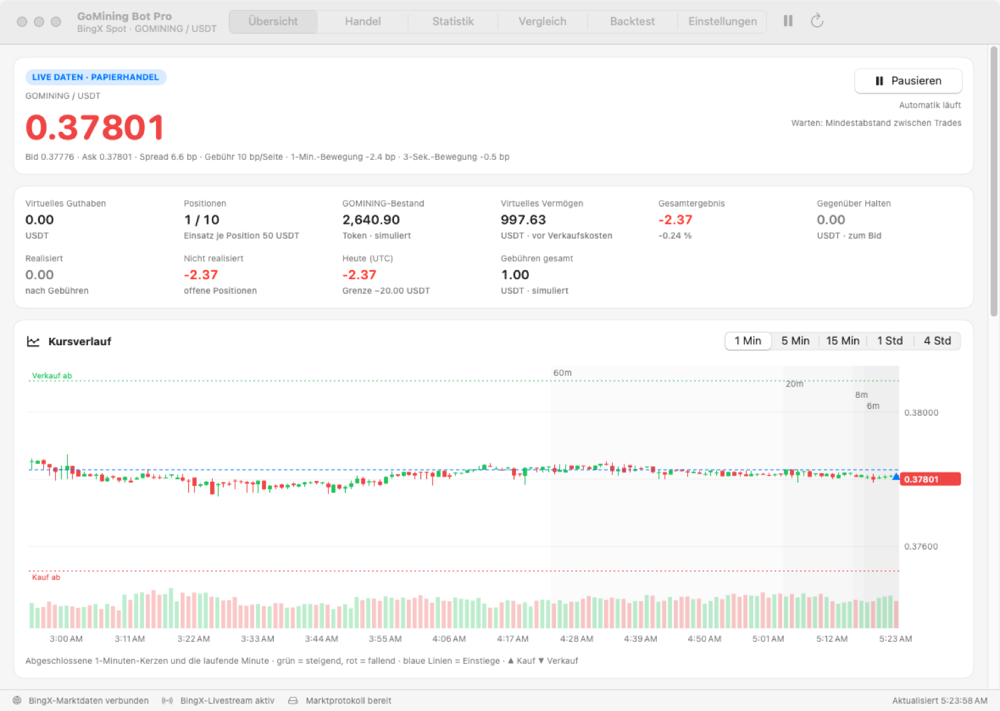

# GoMining Bot 4.0 (macOS)

Papierhandel-Bot für **GOMINING/USDT** auf BingX Spot, mit echten Marktdaten (Orderbuch, Trades, Kerzen) und
**ausschließlich simulierten Orders**. Die App sendet keine Orders an BingX – auch dann nicht, wenn ein API-Schlüssel
verbunden ist (der wird nur zum Anzeigen von Guthaben und Gebührensatz benutzt).

Dieses Verzeichnis enthält den **Quellcode** der App. Von Version 3.9 gab es nur die fertige `GoMining Bot.app`;
der Quellcode wurde daraus rekonstruiert (Datenmodell, Einstellungen, Endpunkte, Texte, Handelslogik) und
weiterentwickelt. Er ist deshalb *nicht* Byte für Byte identisch mit 3.9 – die Strategie ist dieselbe Familie
(adaptiver Kauf- und Verkaufsabstand aus Spread, Gebühren und Volatilität), aber mit Verbesserungen, siehe unten.



*Die Oberfläche mit Live-Daten von BingX (automatisch von der CI aufgenommen).*

## App bekommen

**Variante A – fertig gebaut von GitHub (kein Xcode nötig)**

1. Auf GitHub: Reiter **Actions** → Workflow **„GoMining Bot (macOS-App)“** → den neuesten grünen Lauf öffnen.
2. Unten unter **Artifacts** `GoMining-Bot-macOS` herunterladen und entpacken. Darin liegt `GoMining-Bot.zip`; ein
   Doppelklick darauf ergibt `GoMining Bot.app`.
3. App in den Ordner *Programme* ziehen.
4. **Erster Start:** Die App ist nicht notarisiert (kein Apple-Entwicklerkonto). Rechtsklick auf die App → **Öffnen** →
   **Öffnen**. Falls macOS sie als „beschädigt“ meldet: im Terminal
   `xattr -dr com.apple.quarantine "/Applications/GoMining Bot.app"` ausführen.

**Variante B – selbst bauen** (macOS 14+, Xcode oder `xcode-select --install`)

```bash
cd GoMiningBot
./build_app.sh          # erzeugt dist/GoMining Bot.app und dist/GoMining-Bot.zip (Apple Silicon + Intel)
swift test              # Unit-Tests der Kernbibliothek
```

## Daten aus Version 3.9

Die App nutzt denselben Ordner wie 3.9: `~/Library/Application Support/GoMining Bot/`. Beim ersten Start wird
`simulation.json` gelesen und automatisch ins neue Format überführt; **vorher** wird eine Kopie der alten Datei in
`backups/` abgelegt. Der gespeicherte BingX-Schlüssel (Schlüsselbund-Dienst `com.sebastian.gominingbot.bingx.readonly`)
wird weiterverwendet; macOS fragt beim ersten Zugriff einmal nach der Erlaubnis („Immer erlauben“).

Einmalige Anpassung: Der alte Standard für gleichzeitige Positionen (4 bzw. 8) wird auf **10** angehoben; bewusst
andere Werte bleiben unverändert.

## Neu in 4.0

**Schneller und robuster**

- Livestream (Trades + Orderbuch) ist die Hauptquelle; REST nur für Kerzen und als Fallback, wenn der Stream hakt.
- Automatische Wiederverbindung (1 → 30 s), Wächter bei Stille, neue Verbindung nach dem Aufwachen aus dem Ruhezustand.
- Engine rechnet mit vorberechneten Kennzahlen ohne Speicherzuweisungen im Takt; Oberfläche wird höchstens ~4× pro
  Sekunde aktualisiert. Der Bot läuft auch weiter, wenn das Fenster verdeckt ist (kein App Nap).
- Minuten ohne Trade werden korrekt als „flach“ behandelt – vorher blockierte das bei dünnem Handel mit
  „Kurskerzen veraltet“.
- Speichern atomar im Hintergrund, Sicherungen alle 30 Minuten (12 behalten), Wiederherstellung bei beschädigter Datei,
  Sicherung vor jedem Zurücksetzen.

**Neue Funktionen**

- **Kerzendiagramm** mit echtem Open/High/Low/Close (grün/rot), Volumen, Fadenkreuz, Einstiegslinien, ▲/▼-Marken für
  Käufe und Verkäufe, Linien „Kauf ab“/„Verkauf ab“ und Zeitraum 1 Min / 5 Min / 15 Min / 1 Std / 4 Std.
- **Anstiegs- und Fall-Erkennung** über 6, 8, 20 und 60 Minuten: Nach einem Anstieg (mit roter Gegenkerze) wird nicht
  mehr in den Pump gekauft und früher verkauft; nach einem Fall (mit grüner Kerze) wird nachgekauft. BingX Spot kann
  nicht leerverkaufen – es wird nur Bestand auf- und abgebaut.
- **Backtest** über bis zu 7 Tage 1-Minuten-Kerzen direkt von BingX (weiter zurück gibt die Schnittstelle nichts her;
  längeren Verlauf sammelt die App lokal, solange sie läuft, bis 45 Tage) und **Optimierer** (Rastersuche mit
  Trainings-/Testaufteilung gegen Überanpassung; Ergebnis mit einem Klick übernehmen). 12 Kombinationen auf 7 Tagen
  dauern weniger als eine Sekunde.
- **Statistik:** Gewinnquote, Profit-Faktor, Erwartung je Trade, Ø Gewinn/Verlust, Haltedauer, Drawdown,
  Vermögensverlauf gegen „Halten“, Ergebnis je Tag.
- **Neue Schutzfunktionen** (alle einstellbar): Trailing-Stop, Zeit-Ausstieg, Abkühlphase nach Stop-Loss,
  Drawdown-Grenze, Mindestabstand zwischen Käufen, automatisches Zusammenfassen von Kleinstresten.
- **Menüleiste** mit Kurs, Ergebnis und Start/Pause; **Benachrichtigungen** (Trades, Stop-Loss, Schutzgrenzen) und
  **Preisalarme**.
- **Export:** Trades als CSV (Excel/Numbers, deutsches Format), Sicherung als JSON, „Diagnose kopieren“ für Fehlersuche.
- Verkäufe großer Bestände (z. B. der Startkauf) erfolgen in Tranchen von „Einsatz je Position“.

## So entscheidet der Bot

Pro Marktdurchlauf (Livestream-Ereignis, höchstens ~4× pro Sekunde):

1. **Marktprüfung:** gültiges, frisches Orderbuch; für Käufe zusätzlich frische Kerzen, Spread unter dem Limit und
   etwas Handelsaktivität.
2. **Verkäufe zuerst**, je Los: *Stop-Loss* (Standard 3 %) → *Trailing-Stop* (optional) → *Nettoziel*
   (mindestens „Mindest-Nettoziel“, adaptiv höher bei großem Spread/hoher Volatilität; nach einem Anstieg mit
   Gegenkerze genügt das Minimum). Verkauft wird gegen die echte Orderbuchtiefe, mit Teilverkauf, wenn die Tiefe nicht
   reicht (höchstens 30 % der sichtbaren Tiefe).
3. **Käufe**, wenn alle Grenzen passen (Tagesverlust, Drawdown, Abkühlphase, Abstand zwischen Trades, freie
   Positionen, Bestandsanteil, Guthaben) und einer dieser Auslöser vorliegt:
   *Adaptiver Rückgang* (Kurs fällt um die Kaufschwelle unter das Hoch der letzten Kerzen, Käuferanteil nicht
   schwach), *Schneller Rückgang mit frischem Kaufdruck*, *bestätigter Fall* (6/8/20/60 min) oder
   *Aufwärtstrend mit Kaufdruck*. Im Miner-Wars-Fenster (Dienstag 00:00–18:00 UTC) gelten strengere Schwellen.
4. Kaufschwelle = max(5 bp, 1,5 × Spread + 2 × (Gebühr + Slippage), 2 × Volatilität), begrenzt durch den
   „Maximalen Kaufabstand“; Verkaufsziel = max(Mindest-Nettoziel, 0,5 × Spread, 1,5 × Volatilität).

Alle Kosten (Gebühr je Seite, Slippage, Spread, Orderbuchtiefe, Mindestmenge/-betrag der Börse) fließen in jeden
simulierten Trade ein.

## Grenzen – bitte lesen

- **Keine echten Orders.** Die Echtgeld-Anbindung gibt es bewusst nicht; Papierergebnisse sind kein Beleg dafür, dass
  eine Strategie mit echtem Geld funktioniert (Ausführung, Wartezeiten, Teilausführung, Gebührenstufen).
- **Kein Gewinnversprechen.** Mit den Standardwerten lag der Bot auf 7 Tagen echter Kerzen (Stand 11.10.2026) bei
  −0,5 % (reines Halten: −7,3 %). In einer Parametersuche über 480 Kombinationen war keine Einstellung im Trainings-
  *und* im Testabschnitt zugleich im Plus – Gebühren, Spread und Stop-Loss fressen die kleinen Ziele. Die App ist ein
  Werkzeug zum Ausprobieren und Lernen.
- **Backtest ≠ Zukunft.** Im Backtest gibt es keine historischen Orderbücher; Spread und Tiefe sind Annahmen, und es
  fehlen die Einzeltrades (Käuferanteil). Der Optimierer findet auch im Zufall „gute“ Werte – der Testabschnitt zeigt,
  ob sie halten.
- Die BingX-Parser sind gegen Beispielantworten getestet, nicht gegen die Live-Schnittstelle (die CI hat keinen Zugriff
  auf BingX). Falls die App „Marktdaten eingeschränkt“ meldet: *Einstellungen → Diagnose kopieren* und mitschicken.
- Keine Anlageberatung.

## Entwicklung

```
GoMiningBot/
  Package.swift
  Sources/GoMiningCore/   Modelle, Engine, Orderbuch, Erkennung, Backtest, Statistik, Persistenz, BingX-Parser
  Sources/GoMiningBot/    SwiftUI-App: Controller, Dienste (REST, WebSocket, Schlüsselbund), Oberfläche
  Tests/                  Unit-Tests (XCTest) – laufen in GitHub Actions auf macOS
  Resources/              App-Symbol und Info.plist-Vorlage
  build_app.sh            baut und signiert (ad hoc) die .app
```

Der Workflow `.github/workflows/gomining-bot.yml` führt bei jedem Push `swift test` aus, baut die universelle App und
legt sie als Artefakt ab.
